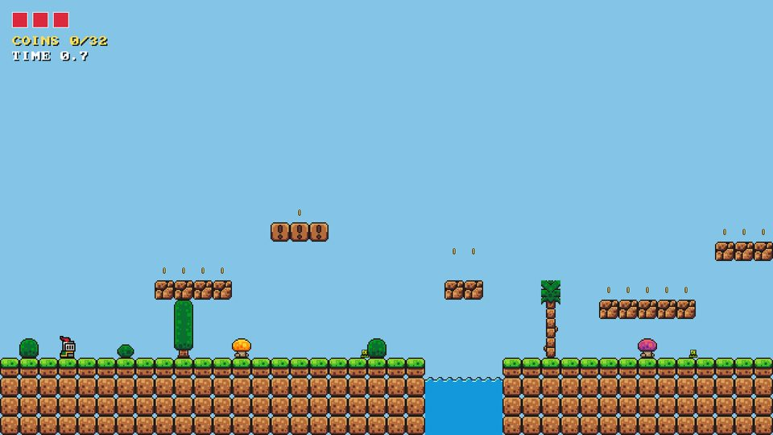

# Knight Platformer

Juego de plataformas completo hecho con **SDL3 + SDL3_image + Box2D 3.1 + pugixml + Tiled**, con la misma
arquitectura que el curso (Engine, módulos, config.xml, Map TMX, Physics, EntityManager, animaciones TSX,
pathfinding). Es el resultado final de la guía “Construye el plataformas” del curso de SDL + Tiled
(lecciones 13, 14 y 15).



## Controles

| Tecla | Acción |
|---|---|
| A / D o flechas | Moverse |
| Espacio | Saltar (mantener = más alto) |
| Enter | Empezar / reintentar |
| H | Ayuda |
| F1 | Reiniciar el nivel |
| F5 / F6 | Guardar / cargar partida (`savegame.xml`) |
| F9 | Ver colliders de Box2D |
| F10 | Modo dios (volar, invencible) |
| F11 | Limitar a 30 fps |
| F12 | Captura de pantalla |
| Esc | Salir |

## Compilar

### Windows (Visual Studio + vcpkg)
1. Instala Visual Studio 2022 con “Desarrollo para el escritorio con C++” (incluye CMake) y vcpkg
   (`git clone https://github.com/microsoft/vcpkg` + `bootstrap-vcpkg.bat`, y define la variable de entorno `VCPKG_ROOT`).
2. *Archivo → Abrir → Carpeta…* y elige esta carpeta. Visual Studio detecta `CMakeLists.txt` y `vcpkg.json`
   y descarga SDL3, SDL3_image, Box2D y pugixml la primera vez (tarda unos minutos).
   Si no lo hace solo, en *Proyecto → Configuración de CMake* pon como *Archivo de cadena de herramientas*
   `%VCPKG_ROOT%/scripts/buildsystems/vcpkg.cmake`.
3. Elige `game.exe` como elemento de inicio y pulsa F5.

### Linux / macOS
```bash
cmake -B build -DCMAKE_TOOLCHAIN_FILE=$VCPKG_ROOT/scripts/buildsystems/vcpkg.cmake
cmake --build build
cd build && ./game
```

## Estructura

```
config.xml              ventana, fps, rutas, parámetros del jugador, monedas y slimes
Assets/Maps/Level1.tmx  el nivel (ábrelo y edítalo con Tiled). Formato de capa: XML
Assets/Textures/*.tsx   animaciones definidas en Tiled
src/                    el código (ver la guía para la explicación línea a línea)
tools/make_level.py     genera el Level1.tmx de ejemplo
tools/autoplay.cpp      prueba automática: juega solo, comprueba 16 cosas y hace capturas
```

## Assets

Sprites, tileset y sonidos del *Brackeys' Platformer Bundle* (analogStudios_, RottingPixels, Brackeys),
licencia **CC0**. Ver `Assets/LICENSE_CREDITS.txt`.
